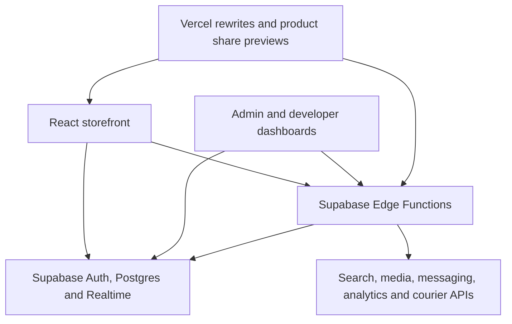

<h1 align="center">
  <a href="https://goodyhut.bd/"></a>
</h1>

<p align="center">
  <strong>A cross-border ecommerce storefront and operations dashboard for China-sourced products in Bangladesh.</strong>
</p>

<p align="center">
  <a href="https://goodyhut.bd/"><strong>Visit GoodyHut</strong></a> ·
  <a href="#storefront">Storefront</a> ·
  <a href="#order-and-fulfillment-flow">Fulfillment</a> ·
  <a href="#operations-dashboard">Operations</a> ·
  <a href="#integrations">Integrations</a> ·
  <a href="#local-development">Local development</a>
</p>

## Overview

GoodyHut gives shoppers one place to browse imported products, compare prices in BDT, estimate air cargo charges, submit payment proof, and track their orders. Staff use the same application to manage the catalog, verify payments, reconcile cargo charges against actual weight, and hand parcels off for domestic delivery.

| Area | What it covers |
| --- | --- |
| **Storefront** | Catalog, category and product pages, text and image search, cart, deals, and checkout |
| **Import operations** | Payment verification, China warehouse and air cargo milestones, customs, cargo adjustments, and last-mile delivery |
| **Commerce dashboard** | Products, categories, orders, reviews, CRM, campaigns, website content, and staff permissions |
| **Developer console** | Integration credentials, Cloudinary media, email and SMS templates, and marketing event analytics |

The cover uses the live storefront's [GoodyHut logo](./src/assets/logo-transparent.png), teal and amber [theme colors](./src/index.css), and Shahriar Nabil's signature mark. Its route animation supports reduced-motion preferences.

## Architecture



- **Frontend.** [React Router](./src/App.tsx) mounts the storefront, staff dashboard, and developer console. TanStack Query supports server state, and shared contexts manage the cart and auth session.
- **Data.** The [Supabase client](./src/integrations/supabase/client.ts) uses generated [database types](./src/integrations/supabase/types.ts). The [SQL migrations](./supabase/migrations) define catalog, order, wallet, marketing, and permission data, with RLS policies, database functions, vector search, and Realtime publication for order changes.
- **Edge and web.** [Supabase Edge Functions](./supabase/functions) handle external services and scheduled order cleanup. [Vercel routes](./vercel.json) serve the SPA and proxy the sitemap and catalog feed. [Middleware](./middleware.ts) routes selected crawlers to the [product preview handler](./api/og.ts).

## Storefront

| Feature | Implementation |
| --- | --- |
| **Browse and discover** | Homepage banners, category hierarchy, trending items, timed deals, and campaign pages. [Home](./src/pages/Index.tsx) · [Categories](./src/pages/CategoryPage.tsx) · [Deals](./src/pages/DealsPage.tsx) · [Campaigns](./src/pages/CampaignPage.tsx) |
| **Text and image search** | Search overlay with text suggestions and recent searches. Signed-in users can search with a product photo. The search function uses image and text embeddings, with a database text-search fallback. [Overlay](./src/components/SearchOverlay.tsx) · [Search results](./src/pages/SearchResults.tsx) · [Search function](./supabase/functions/smart-search/index.ts) |
| **Product detail** | Image galleries, variant selection, variant-level price and weight, estimated cargo charges, stock display, related items, and customer reviews with optional images. [Product page](./src/pages/ProductDetail.tsx) |
| **Cart and checkout** | Session-backed cart, Bangladesh address picker, deals and campaign pricing, customer discounts, coupons, wallet credit, and a choice of full payment or a 40% deposit. [Cart](./src/contexts/CartContext.tsx) · [Address picker](./src/components/AddressPicker.tsx) · [Checkout](./src/pages/Checkout.tsx) |
| **Account and tracking** | Phone and password sign-in, SMS OTP flows, Google OAuth, account and address editing, order history, wallet transactions, phone-based order lookup, and an order timeline. [Sign-in](./src/components/AuthModal.tsx) · [Profile](./src/pages/ProfilePage.tsx) · [Phone lookup](./src/pages/TrackOrderByPhone.tsx) · [Timeline](./src/pages/TrackOrder.tsx) |
| **Support and policies** | Help, contact, shipping and customs guides, returns, privacy, and terms pages. [Help center](https://www.goodyhut.bd/help) · [Shipping guide](https://www.goodyhut.bd/shipping) · [Customs guide](https://www.goodyhut.bd/customs-guide) |

## Order and fulfillment flow

| Stage | What happens |
| --- | --- |
| **1. Estimate** | Checkout calculates international cargo from product and variant weights, category rates, and per-piece or product-specific overrides. Domestic delivery charges are calculated after arrival in Bangladesh and paid on delivery. [Shipping calculations](./src/lib/shippingUtils.ts) · [Checkout](./src/pages/Checkout.tsx) |
| **2. Place and pay** | Checkout can save a draft. On submission it records the order and items. The customer uploads a payment screenshot after a bKash, Nagad, or IFIC Bank transfer. Staff review proof and verify the payment. [Checkout](./src/pages/Checkout.tsx) · [Payment](./src/pages/Payment.tsx) |
| **3. Move the shipment** | The order timeline records purchasing, receipt at the China warehouse, air cargo, and arrival in Bangladesh or customs. [Order timeline](./src/pages/TrackOrder.tsx) |
| **4. Reconcile actual charges** | Staff record actual weight and recalculate the cargo bill. The workflow handles additional payment or a wallet credit for an overestimate. [Order management](./src/pages/admin/OrderManagement.tsx) · [Due payment](./src/pages/Payment.tsx) |
| **5. Deliver** | Staff can book a Steadfast consignment, fetch courier status, and receive webhook updates as the parcel moves toward delivery. The customer timeline refreshes on order changes. [Booking](./supabase/functions/steadfast-order/index.ts) · [Status](./supabase/functions/steadfast-status/index.ts) · [Webhook](./supabase/functions/steadfast-webhook/index.ts) |

The [stale-order function](./supabase/functions/cancel-stale-orders/index.ts) cancels orders that have awaited payment for more than six hours. The [cron migration](./supabase/migrations/20260312005821_044548fd-7e5c-4405-b0f5-84ac6efce87e.sql) defines a 30-minute schedule for the check.

## Operations dashboard

| Module | Capabilities |
| --- | --- |
| **Dashboard and orders** | Sales, order, product, and customer summaries. Order filtering, status history, payment review, weight entry, wallet adjustments, courier checks and dispatch, and Realtime updates. [Dashboard](./src/pages/admin/Dashboard.tsx) · [Orders](./src/pages/admin/OrderManagement.tsx) |
| **Catalog and reviews** | Product and category management, variants, prices, images, cargo rates, metadata, search embeddings, and review moderation. [Catalog](./src/pages/admin/ProductManagement.tsx) · [Product editor](./src/pages/admin/ProductForm.tsx) · [Categories](./src/pages/admin/CategoryManagement.tsx) · [Reviews](./src/pages/admin/ReviewManagement.tsx) |
| **CRM and promotions** | Customer history, account and wallet actions, customer-specific discounts, coupons, customer and bulk SMS, product deals, and campaigns. [CRM](./src/pages/admin/CRM.tsx) · [Bulk SMS](./src/pages/admin/BulkSMS.tsx) · [Deals](./src/pages/admin/DealManagement.tsx) · [Campaigns](./src/pages/admin/CampaignManagement.tsx) |
| **Website editor** | Hero slides, editable content pages, and footer settings. [Website settings](./src/pages/admin/WebsiteSettings.tsx) |
| **Roles and moderation** | Admin role and page-permission lookups, developer console access checks, staff permission controls, and IP blocks. [Admin access](./src/hooks/useAdmin.ts) · [Developer access](./src/hooks/useDeveloper.ts) · [Staff permissions](./src/pages/admin/AdminManagement.tsx) · [IP blocks](./src/pages/admin/BlockedIPs.tsx) |
| **Developer console** | Integration configuration, Cloudinary asset management, email and SMS templates, and conversion tracking and event views. [Developer layout](./src/pages/dev/DevLayout.tsx) · [Integration settings](./src/pages/dev/ApiManagement.tsx) · [Tracking settings](./src/pages/dev/TrackingSettings.tsx) · [Tracking events](./src/pages/dev/TrackingAnalytics.tsx) |

## Integrations

| Integration | Role in GoodyHut |
| --- | --- |
| **Supabase Auth and Google OAuth** | Session management, phone-based authentication, account updates, and Google sign-in. [Auth context](./src/contexts/AuthContext.tsx) · [Account email update](./supabase/functions/update-user-email/index.ts) |
| **BulkSMSBD** | Supabase Send SMS Hook for OTP delivery, order updates, promotional sends, and SMS balance checks. [SMS hook](./supabase/functions/send-sms-hook/index.ts) · [Order SMS](./supabase/functions/send-order-sms/index.ts) · [Promo SMS](./supabase/functions/send-promo-sms/index.ts) |
| **Resend** | Template-based email sending and delivery-event webhooks with signature verification. [Templates](./src/pages/dev/EmailTemplates.tsx) · [Sender](./supabase/functions/send-email/index.ts) · [Webhook](./supabase/functions/resend-webhook/index.ts) |
| **Steadfast and BD Courier** | Consignment booking and status updates through Steadfast. BD Courier provides a separate customer courier history lookup. [Steadfast](./supabase/functions/steadfast-order/index.ts) · [BD Courier](./supabase/functions/check-courier/index.ts) |
| **Cloudinary** | Uploads and transformations for catalog images, review photos, and payment proof, plus a media manager for developers. [Image helpers](./src/lib/cloudinary.ts) · [Media management](./supabase/functions/dev-cloudinary/index.ts) · [Payment proof](./src/pages/Payment.tsx) |
| **Jina AI and pgvector** | `jina-clip-v2` creates text and image embeddings for product discovery. PostgreSQL matches those vectors and supports a text-search fallback. [Indexing](./supabase/functions/generate-embeddings/index.ts) · [Search](./supabase/functions/smart-search/index.ts) |
| **Hugging Face** | Product editor support for generating SEO titles, descriptions, and keywords. [SEO function](./supabase/functions/generate-seo/index.ts) |
| **GTM, GA4, and Meta** | Configurable browser tags, commerce events with a shared Pixel and CAPI event ID, Meta Conversions API, and the Meta product catalog feed. [Browser tags](./src/components/TrackingHead.tsx) · [Events](./src/hooks/useTracking.ts) · [CAPI](./supabase/functions/meta-capi/index.ts) · [Catalog feed](./supabase/functions/meta-catalog/index.ts) |

### Search indexing and previews

- [Robots rules](./public/robots.txt) point crawlers to the [dynamic sitemap](https://www.goodyhut.bd/sitemap.xml) generated by an [Edge Function](./supabase/functions/sitemap/index.ts).
- [Product detail](./src/pages/ProductDetail.tsx) supplies product metadata and JSON-LD. [Vercel middleware](./middleware.ts) and the [preview handler](./api/og.ts) provide product Open Graph metadata to supported crawlers.

<details>
<summary><strong>All 25 Edge Functions by workflow</strong></summary>

| Workflow | Functions |
| --- | --- |
| Identity and administration | `admin-users`, `phone-auth`, `send-otp`, `send-sms-hook`, `update-user-email` |
| Order operations | `cancel-stale-orders`, `check-order-apis` |
| Courier | `check-courier`, `steadfast-order`, `steadfast-status`, `steadfast-webhook` |
| Email and SMS | `check-sms-status`, `resend-webhook`, `seed-email-templates`, `send-email`, `send-order-sms`, `send-promo-sms` |
| Media and configuration | `dev-cloudinary`, `dev-secrets` |
| Search and SEO | `generate-embeddings`, `generate-seo`, `smart-search` |
| Catalog and marketing | `meta-capi`, `meta-catalog`, `sitemap` |

[Function source directory](./supabase/functions)

</details>

## Stack and versions

Versions below come from the checked-in [Bun lockfile](./bun.lock). The repo also has a [verified npm lockfile](./package-lock.json).

| Layer | Packages or services | Version |
| --- | --- | --- |
| Frontend | React and React DOM, React Router DOM, TanStack React Query | `18.3.1`, `6.30.1`, `5.83.0` |
| Build and language | Vite, React SWC plugin, TypeScript | `5.4.19`, `3.11.0`, `5.8.3` |
| UI and interactions | Tailwind CSS, local shadcn/ui components, Radix UI, Framer Motion, Lucide, dnd-kit | `3.4.17` for Tailwind, `12.36.0` for Framer Motion, `0.462.0` for Lucide, per-package versions below |
| Forms | React Hook Form, Hook Form Resolvers, Zod | `7.61.1`, `3.10.0`, `3.25.76` |
| Backend | Supabase JS, PostgreSQL, Supabase Edge Functions | `2.99.1` for the client, managed database and Deno runtime |
| Hosting integration | Vercel Node API types and runtime tooling | `5.6.22` |
| Verification | Vitest, Testing Library, ESLint | `3.2.4` for Vitest, per-package versions below |

<details>
<summary><strong>All 57 direct dependencies and Bun-locked versions</strong></summary>

| Package | Version | Scope |
| --- | --- | --- |
| `@dnd-kit/core` | `6.3.1` | Application |
| `@dnd-kit/sortable` | `10.0.0` | Application |
| `@dnd-kit/utilities` | `3.2.2` | Application |
| `@eslint/js` | `9.32.0` | Tooling |
| `@hookform/resolvers` | `3.10.0` | Application |
| `@radix-ui/react-accordion` | `1.2.11` | Application |
| `@radix-ui/react-alert-dialog` | `1.1.14` | Application |
| `@radix-ui/react-avatar` | `1.1.10` | Application |
| `@radix-ui/react-checkbox` | `1.3.2` | Application |
| `@radix-ui/react-dialog` | `1.1.14` | Application |
| `@radix-ui/react-dropdown-menu` | `2.1.15` | Application |
| `@radix-ui/react-label` | `2.1.7` | Application |
| `@radix-ui/react-popover` | `1.1.14` | Application |
| `@radix-ui/react-radio-group` | `1.3.7` | Application |
| `@radix-ui/react-select` | `2.2.5` | Application |
| `@radix-ui/react-separator` | `1.1.7` | Application |
| `@radix-ui/react-slot` | `1.2.3` | Application |
| `@radix-ui/react-switch` | `1.2.5` | Application |
| `@radix-ui/react-tabs` | `1.1.12` | Application |
| `@radix-ui/react-toast` | `1.2.14` | Application |
| `@radix-ui/react-tooltip` | `1.2.7` | Application |
| `@supabase/supabase-js` | `2.99.1` | Application |
| `@tailwindcss/typography` | `0.5.16` | Tooling |
| `@tanstack/react-query` | `5.83.0` | Application |
| `@testing-library/jest-dom` | `6.9.1` | Tooling |
| `@testing-library/react` | `16.3.2` | Tooling |
| `@types/node` | `22.16.5` | Tooling |
| `@types/react` | `18.3.23` | Tooling |
| `@types/react-dom` | `18.3.7` | Tooling |
| `@vercel/node` | `5.6.22` | Application |
| `@vitejs/plugin-react-swc` | `3.11.0` | Tooling |
| `autoprefixer` | `10.4.21` | Tooling |
| `class-variance-authority` | `0.7.1` | Application |
| `clsx` | `2.1.1` | Application |
| `date-fns` | `3.6.0` | Application |
| `eslint` | `9.32.0` | Tooling |
| `eslint-plugin-react-hooks` | `5.2.0` | Tooling |
| `eslint-plugin-react-refresh` | `0.4.20` | Tooling |
| `framer-motion` | `12.36.0` | Application |
| `globals` | `15.15.0` | Tooling |
| `jsdom` | `20.0.3` | Tooling |
| `lucide-react` | `0.462.0` | Application |
| `postcss` | `8.5.6` | Tooling |
| `react` | `18.3.1` | Application |
| `react-day-picker` | `8.10.1` | Application |
| `react-dom` | `18.3.1` | Application |
| `react-hook-form` | `7.61.1` | Application |
| `react-router-dom` | `6.30.1` | Application |
| `sonner` | `1.7.4` | Application |
| `tailwind-merge` | `2.6.0` | Application |
| `tailwindcss` | `3.4.17` | Tooling |
| `tailwindcss-animate` | `1.0.7` | Application |
| `typescript` | `5.8.3` | Tooling |
| `typescript-eslint` | `8.38.0` | Tooling |
| `vite` | `5.4.19` | Tooling |
| `vitest` | `3.2.4` | Tooling |
| `zod` | `3.25.76` | Application |

</details>

## Local development

Use Node.js 20 or newer with npm. The Vite development server listens on port `8080`.

```bash
git clone https://github.com/ShahNabil1/GoodyHut.git
cd GoodyHut
npm ci
npm run dev
```

Bun users can run `bun install --frozen-lockfile` followed by `bun run dev`.

```bash
npm test
npm run lint
npm run build
npm run preview
```

The browser client and Vercel product preview currently point to the GoodyHut Supabase project using client-safe anonymous credentials. For an isolated environment, configure your own [Supabase client](./src/integrations/supabase/client.ts), [function project](./supabase/config.toml), [Vercel rewrites](./vercel.json), and [preview handler](./api/og.ts), then provision the [migrations](./supabase/migrations) and the [functions](./supabase/functions) required by the workflows you want to test. Configure `VITE_SUPABASE_PROJECT_ID` for the developer email analytics view. Integration secrets belong in the server-side function environment or the authorized developer console.

## Developer

<p>
  <a href="https://shahnabil.com/"></a>
</p>

**Shahriar Nabil** · Developer contact

[Website](https://shahnabil.com/) · [Email](mailto:hello@shahnabil.com) · [Call +8801790736863](tel:+8801790736863) · [WhatsApp](https://wa.me/8801790736863) · [GitHub](https://github.com/ShahNabil1)
