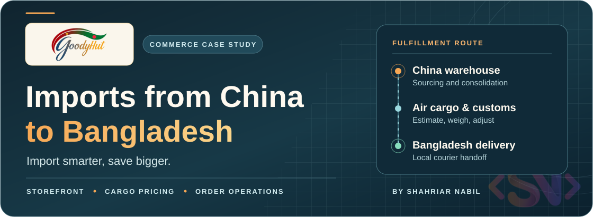

<h1 align="center">
  
</h1>

  <strong>A cross-border storefront and order operations dashboard for China-sourced products in Bangladesh.</strong>

  <a href="https://goodyhut.bd/"><strong>Visit GoodyHut</strong></a> ·
  <a href="#shopping-experience">Shopping experience</a> ·
  <a href="#fulfillment-journey">Fulfillment journey</a> ·
  <a href="#design-and-technology">Technology</a>

## Project overview

GoodyHut gives shoppers a Bangladesh-facing storefront for products sourced from China. The project connects product discovery and checkout to international cargo, arrival in Bangladesh, and domestic delivery. The operations dashboard lets the team manage each stage of that journey.

## Shopping experience

| Area | What shoppers can do |
| --- | --- |
| Discover products | Browse categories, trending products, deals, and campaigns. Search by text or, when signed in, by product photo. |
| Compare options | Review photos, variants, availability, prices in BDT, and estimated cargo charges. |
| Place an order | Use discounts or wallet credit where eligible, choose full payment or a deposit, and submit proof of payment. |
| Track and get help | Follow order milestones, review wallet activity, and consult the shipping, customs, and returns guides. |

[Browse GoodyHut](https://goodyhut.bd/) · [Shipping guide](https://www.goodyhut.bd/shipping)

## Fulfillment journey

1. **Estimate the cargo.** The storefront shows an estimate based on the selected items and their shipping characteristics.
2. **Verify payment and source the order.** Staff review payment proof and record milestones from purchase and receipt at the China warehouse to air cargo and arrival in Bangladesh.
3. **Adjust and dispatch.** Staff use the recorded weight to reconcile cargo charges, collect a balance or credit the customer's wallet when applicable, and hand the parcel to a domestic courier.
4. **Update the customer.** The order timeline shows delivery progress from the courier handoff to completion.

## Operations dashboard

The team can maintain products, variants, images, and categories, manage deals and campaign pages, moderate reviews, and support customers from the CRM. Staff also have tools for payment review, order history, cargo adjustments, courier bookings, and delivery updates.

## Design and technology

The teal and amber cover follows the storefront brand and depicts the route from the China warehouse to delivery in Bangladesh.

| Area | Technology and role |
| --- | --- |
| Web application | React, TypeScript, Vite, and Tailwind CSS power the storefront and operations dashboard. |
| Data and search | Supabase and PostgreSQL support account and order data. Text and image matching power product discovery. |
| Fulfillment | Steadfast supports last-mile booking and tracking. |
| Media and measurement | Cloudinary serves product and review imagery. Google Analytics and Meta support storefront measurement. |

## Developer

  

**Shahriar Nabil** · [Portfolio](https://shahnabil.com/) · [GitHub](https://github.com/ShahNabil1)
